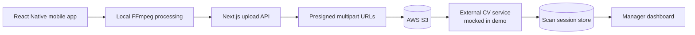

# MoveScan OS

**A resilient mobile video-to-inventory vertical slice for residential moving operations.**

**Live demo:** https://movescan-ops-demo.parthnikam.chatgpt.site

This is an independent technical proof of concept inspired by public B2B logistics requirements. It is not MovTexAI software, does not use their branding, and does not claim to implement proprietary computer vision. The vision provider and hosted demo storage are clearly mocked; the production S3 path is implemented behind the same API contract.

## What it proves

- React Native capture/import architecture and CV-conscious local FFmpeg compression
- original vs. optimized metadata, timing, and reduction reporting
- backend-created S3 multipart uploads using short-lived presigned URLs
- part-level progress, cancel, retry, expired-URL recovery, and idempotent completion
- typed REST boundaries and a replaceable mocked external CV adapter
- a responsive Next.js operations dashboard with seeded success and failure states
- private-hosted dashboard authentication, role-ready server authorization hooks, and a polished login screen

## Architecture



The mobile client never receives an AWS secret. It requests an upload ID and scoped URLs from the backend, uploads 16 MiB chunks directly to S3, then returns part numbers and ETags for server-side validation and completion. This avoids routing large video bodies through the app server while retaining authorization, audit, and idempotency controls.

## Mobile video strategy

Reference FFmpeg profile:

```sh
-vf scale=1280:720 -c:v libx264 -crf 23 -preset medium \
  -c:a aac -b:a 96k -movflags +faststart
```

This profile intentionally favors model usefulness over maximum compression. Production tuning should be measured against CV recall/precision using representative rooms, lighting, motion, and device hardware. `ffmpeg-kit-react-native` needs an Expo development build; it does not run in Expo Go.

## Repository map

```text
app/                  Next.js dashboard pages and REST routes
components/           reusable dashboard and simulator UI
lib/                  compression, multipart, auth, S3, and mock CV logic
mobile/               Expo/React Native reference client
tests/                focused pipeline tests
docs/PROOF_OF_WORK.md proposal copy and demo script
```

## Run the dashboard

Requirements: Node 22.13+.

```sh
cp .env.example .env.local
npm install
npm run dev
```

Open `http://localhost:5173`. Useful routes:

- `/` — operational overview
- `/mobile-demo` — interactive end-to-end simulator
- `/scans` — complete scan list
- `/scans/MS-2841` — completed inventory
- `/scans/MS-2838` — failed upload recovery
- `/login` — role-ready access screen

## Run the mobile client

```sh
cd mobile
npm install
npx expo prebuild
npm run ios # or npm run android
```

Set `EXPO_PUBLIC_API_URL` to a backend URL reachable from the device. Because FFmpeg uses native code, use an Expo development build.

## Demo mode vs. AWS

`DEMO_MODE=true` is the default and needs no credentials. It preserves the production request/response shape and marks mocked behavior in the interface.

To connect S3:

1. Create a private bucket with CORS allowing `PUT` from the mobile origin and `ETag` in exposed headers.
2. Grant the backend role `s3:CreateMultipartUpload`, `s3:UploadPart`, `s3:CompleteMultipartUpload`, and `s3:AbortMultipartUpload` for the scan key prefix.
3. Set `DEMO_MODE=false`, `AWS_REGION`, and `S3_BUCKET`; use an IAM workload role in production. Local access keys belong only in `.env.local` and are ignored by Git.
4. Replace the mock CV adapter with the real server-to-server request and webhook/status mapping.

## API surface

- `POST /api/uploads/initiate`
- `PUT /api/uploads/part` (demo S3 stand-in)
- `POST /api/uploads/complete`
- `POST /api/uploads/cancel`
- `GET|POST /api/scans`
- `GET /api/scans/:id`
- `POST /api/scans/:id/process`
- `GET /api/scans/:id/status`

Invalid input returns structured `4xx` errors. Completion checks every expected part and is idempotent. The demo store is intentionally ephemeral; production would use PostgreSQL/Prisma or an equivalent durable store with unique upload and provider-job constraints.

## Security notes

- Secrets never enter browser or mobile bundles.
- Presigned URLs expire after 15 minutes and should be scoped to one key and part.
- File MIME type and the 750 MiB size cap are validated before initialization.
- Protected APIs should validate the authenticated server identity and organization membership; the demo includes a role-ready request boundary.
- Production hardening: magic-byte validation, malware scanning, per-org rate limits, signed CV webhooks, KMS encryption, audit logs, least-privilege IAM, and lifecycle rules for abandoned multipart uploads.

## Verification

```sh
npm test
npm run build
```

Tests focus on the compression profile, multipart planning, completion validation, size limits, and state transitions. See [the application kit](docs/PROOF_OF_WORK.md) for the demo script, proposal paragraph, talking points, and client questions.
